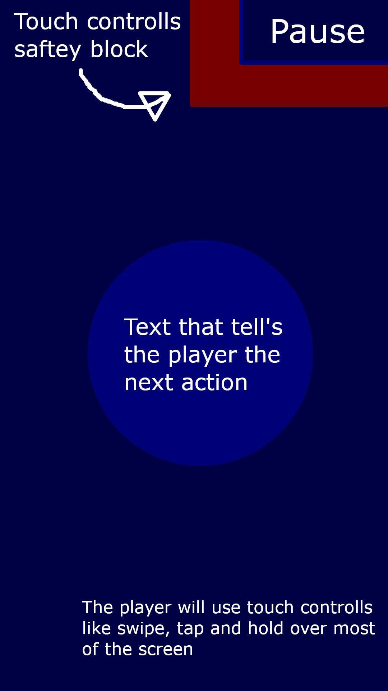
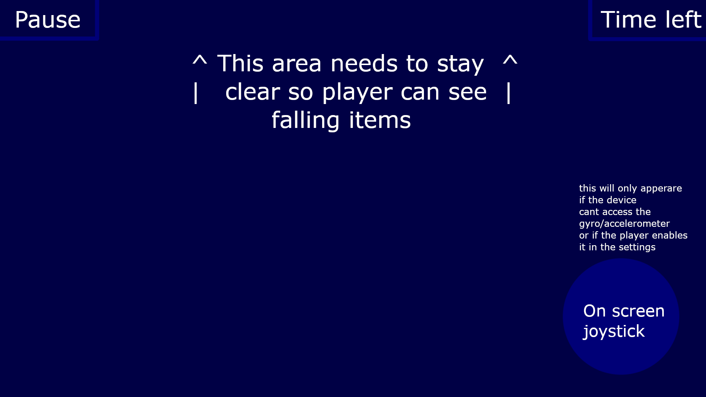
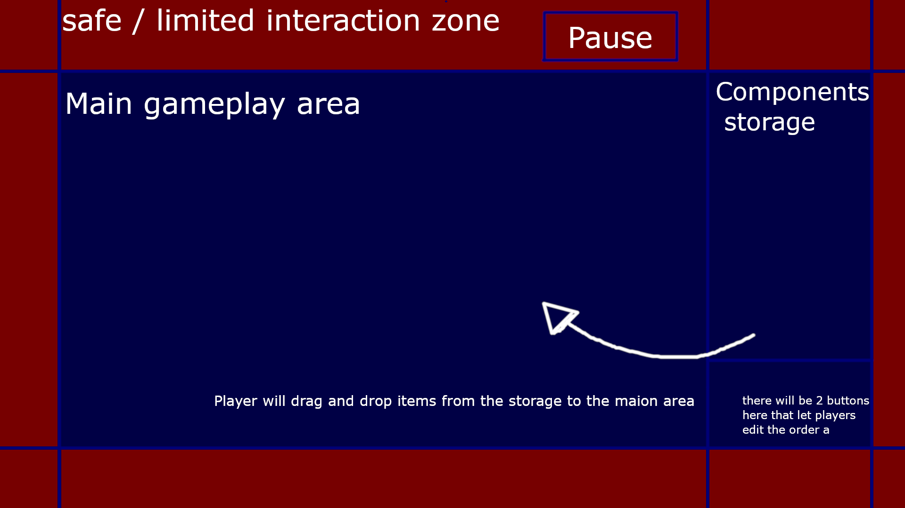

## Target audience
The target audience of my game is going to be people who are competitive and who enjoy comparing their score with their friends. Following this it will also be targeted more so towards people who want to sit down and focus on playing, however id like to add some functionality for more casual play.

## Game concept 
A collection of 3 minigames, completing these minigame’s will grant points that will be used to show your position on the leaderboards, these points will reset weekly. The leaderboards will be split into 2 one that shows the current weeks high score and one that shows the best score from any of the previous weeks.
### Minigame 1 
similar to bop it where the game gives you a word and you need to do the associated action like {Shake, tap, hold, swipe}
### Minigame 2 
you control a construction worker who is trying to balance on a steel beam while things fall from the sky
### Minigame 3 
a puzzle minigame where you need to make a machine work correctly, each part of the machine will have a set patter it follows. For example, one might grab a block and move it in a direction, another might grab said block and turn it into another

The first 2 minigames will be unlimited due to the ability to randomise the patterns. However, this cannot be done as easily as the first 2. To keep this one relevant the game will score based on how efficient the machine is, meaning if a player only uses 4 pieces it will get a better score than one that uses 6.
There will also be a custom build version that lets players make their own machine challenges and upload them for 
others to try, out of fairness the creator must be able to pass it before they upload it.
Finaly there will also be a daily challenge that will give more score for the same difficulty than the normal mini-games, local notificasions could be used to remind the player about these dailiy challenges.

## Target mobile platform & orientation
My target mobile platform will be android, with each minigame focusing on a different orientation with the first being landscape and both the second and third being portrait.

## Gameplay loop
The gameplay loops will go as follows.

### Minigame one
Action given -> player completes action within time period -> action given -> player completes action within shorter time period ----> player fails to complete action within time limit –> player gains score based on how many actions they fulfilled.
### Minigame two 
Item falls down from sky -> player tilts phone / uses onscreen joystick to move character out of the way while keeping balance in mind-> loop -> player either gets hit or falls off due to balance.
### Minigame three 
Player looks at challenge lay out -> places different components -> attempts solve  -> fail = reattempt, win = gain score based on number of components used
Interface wire frames 

## Touch controls 
With this game being broken down into 3 diffrent minigame's, each minigame will use slightly diffrent touch controlls. for example the first minigame will use a large selection of diffrent inputs to complete the actiuons, for example double tap, hold, swipe, pinch. all of these could be options for touch controlls, however testing for which fell best when playing will be important before solidifying the choices.

For the second minigame it will primarily be played using gyro/accelometer inputs, so unless the player enables the onscreen joystick there wont be any touch controlls.

finaly the last game will primarily use drag for moving the components onto the main play area.

## Selected features 
- Unity leaderboard 
- Haptic feedback 
- Accelerometer / gyro
- Local notifications 

## UI Wireframe

### minigame 1

### minigame 2

### minigame 3

