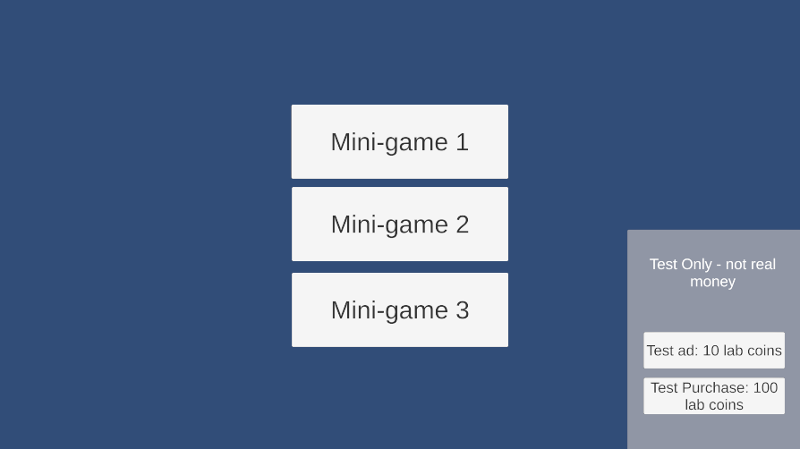

# week 8 lab Monetisation documentation 

## test profile of lab system
| Tested item | Expected result | Observed result | Pass or Fail |
|--|--|--|--|
| Ad / shop unavalibility | when the values are set to unavalible the buttons shouldnt work | Buttons correctly show as unavalible when value changed | P |
| Ad canceled | When the value of the ad is set to canceld, the button should stay active but not add any currency | Worked as intended with message stateing add not proccessed | P |
| Rewards earned once | When the ad button is enabled upon pressing it, the lab coins value should go up by 10 and the button should deactiviate | Expected outcome occured | P |
| First order and replay | when the purchase button is pressed it should add 100 coins to the value, but upon being pressed again it should not change coin count | Expected result occured | P |
| Failed Save | When the order id dosent match (and simulate save fail is true) the coin count shouldnt change and the order should be ignored | Expected result occured | P |
| Retry same order | When the simulate order fail is false the buttons should increment the coin value by the expected amount again, continuing to block buttons afterwards | Expected outcome occured | P |

## in engine evidence

## Monetisation Plan
### Monetisation model
The model i am going to follow for my monetisation will be Ad's that occur after finishing a level at periodic times, they should occur more often upon a successfull completion rather than after loses due to players being more forgiving at that time.
### Target audience for Monetisation 
### Reward placement
Rewards will be offerd to players after they complete a level that they have been struggeling with. (e.g if they have attempted it multiple times or have taken a long time to complete it). but they should also periodicly occur otherwise.
### Consumable or cosmetic 
#### consumables
Consumables in my game will let the player recover lost energy from earlier in the month, this extra energy will have a hard limit matching energy lost. the idea behind this is to keep the game competative and not pay to win, but if someone misses a day they can recover their losses
#### cosmetics 
Cosmetics will be sold in pack, each pack will hold cosmetics for each minigame. (e.g a christmas pack that makes the character on minigame 2 santa and the workers in minigame 3 elves. minigame 1 could change to be santas workshop instad of the insides of a machine)
### What i want to avoid selling 
what i want to avoid selling is anything that could give a competative adavtage, an extra life for example. I would consider that a "competitive advantage" for my game due to the limited energy mechanic. if players could buy extra lives that would cause an unfair advantage.
### free route when disconected from network

## changes for a live release
